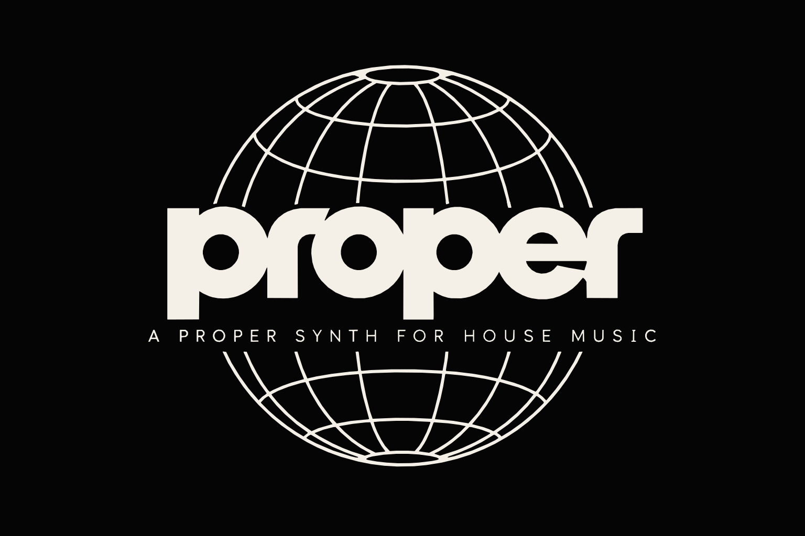

<p align="center">
  
</p>

# Proper

[](https://github.com/VouDoo/proper-synth/actions/workflows/ci.yml)
[](https://github.com/VouDoo/proper-synth/actions/workflows/build.yml)
[](LICENSE)

**A proper synth for house music, innit.**

Four-operator FM, built from scratch in Rust for 2-step, speed garage and UK house. Organ stabs that hit, basslines that talk, keys that make the whole room put their hands up. Runs on its own as an app, and builds as a CLAP/VST3 plugin too. Bo! 🔊

---

## What's it got, then?

- **4-operator FM engine.** 8 algorithms, operator feedback for that saw-wave grit, key tracking, velocity on every operator.
- **Resonant filter on every note.** It's got its own envelope, key tracking and velocity, so stabs *bow* and plucks *blip*, proper analog-style.
- **Vowel.** Makes any sound sing **A → E → I → O → U**. Vocal-chop vibes with no samples, no clearance, no stress.
- **LFO, synced to the tempo.** Pitch (vibrato), Wobble (FM brightness), Volume (tremolo) and Cutoff (the speed garage wobble). From 1/1 down to 1/32, dotted and triplets included for that shuffle.
- **Mono with glide.** Overlap your notes and the bassline slides, like the classic bass synths.
- **Stereo chorus.** Width for days.
- **20 presets**, all level-matched so nothing jumps out when you flick through.
- **Clean as anything.** 2× oversampling against aliasing, a lookahead limiter instead of nasty clipping, no clicks when voices get stolen, and smooth knobs with no zipper noise.
- **Light on the CPU.** About 10–17% of one core with 32 notes going at once, about 1% for the mono basses. 2 ms of latency all in.

Notes only on the MIDI side: map your controller's knobs to the parameters in your DAW. Keeps it simple, bruv.

---

## The presets 🎛️

| Preset | What it does |
|---|---|
| **Garage Organ** | The speed garage organ. Bright, hollow, clicky. Pure 1998. |
| **Gospel Organ** | Soulful house organ with a rotary-speaker swirl. Church on a Sunday, rave on a Saturday. |
| **2-Step Stab** | Short, buzzy chord hits for swung 2-step patterns. |
| **Revival Stab** | Warm, detuned analog-style stab that bows open on every hit. |
| **House Brass** | Chicago brass hit. Big up the originators. |
| **Garage Keys** | Punchy garage piano for chord stabs. |
| **Warm Keys** | Deep-house electric piano with tremolo and chorus. Lush. |
| **Bell Lead** | Bright bell hook, slightly metallic. |
| **Pluck Lead** | Snappy pluck for riffs and hooks. |
| **Arp Pluck** | Tiny resonant blip for fast 16th arpeggios. |
| **Vox Chop** | Bright pluck singing "ah". Chopped-vocal energy. |
| **Felt Pad** | Slow, warm pad for when the drop needs a breather. |
| **Lush Pad** | Brighter, wider, drifting pad for emotional breakdowns. |
| **Choir Pad** | The classic house "aaah". You know the one. |
| **Speed Bass** | Gritty saw-like bass with an octave-down growl. |
| **Wobble Bass** | The speed garage wobble, locked to your tempo. Rewind! |
| **Organ Riff Bass** | Hollow organ bass for hypnotic riffs that won't leave your head. |
| **Growl Bass** | Raw, growling bass that moves on the quarter notes. |
| **Pluck Bass** | Rubbery FM house bass over a clean sub. |
| **Sub Bass** | Clean sub with a little knock, so it still slaps on small speakers. |

All four basses are mono with glide, so overlap your notes and they slide.

---

## Download it 📦

Grab the zip for your system from the [**Releases**](https://github.com/VouDoo/proper-synth/releases) page. No Rust needed.

| System | Zip | Inside |
|---|---|---|
| Linux | `proper-linux` | `Proper` (app), `Proper.clap`, `Proper.vst3` |
| macOS (Apple Silicon and Intel) | `proper-macos` | `Proper.app`, `Proper.clap`, `Proper.vst3` |
| Windows | `proper-windows` | `Proper.exe` (app), `Proper.clap`, `Proper.vst3` |

Every zip has an `INSTALL.txt` with where to put the plugins. Heads up: the builds aren't signed, so macOS and Windows will moan the first time you open them. The install notes show how to get past that. And real talk: it's been played loads on Linux, but the Windows and macOS builds are fresh off the CI and still need a proper road test.

---

## Build it yourself 🛠️

### What you need
- **Rust** (stable, with 2024 edition support), via [rustup](https://rustup.rs).
- On **Linux**: the ALSA, X11 and OpenGL development libraries. On Arch-based systems they're usually there already. On Debian/Ubuntu:
  ```sh
  sudo apt install libasound2-dev libgl-dev libjack-dev libx11-xcb-dev libxcb1-dev libxcb-dri2-0-dev libxcb-icccm4-dev libxcursor-dev libxkbcommon-dev libxcb-shape0-dev libxcb-xfixes0-dev
  ```
- A **MIDI keyboard**. Any will do; it's been played on an Akai MPK mini 3.

### Build it
```sh
cargo build --release
```

### Play it
These commands are for Linux. On macOS and Windows, leave out `-b alsa`.

First find your keyboard's name. An empty name makes the app list every MIDI device it can see:
```sh
./target/release/proper_synth -b alsa --midi-input ""
```

Then pull up:
```sh
./target/release/proper_synth -b alsa --midi-input "MPK mini 3:MPK mini 3 MIDI 1 28:0" --tempo 125 -p 128
```

| Option | What it does |
|---|---|
| `-b alsa` | Use ALSA for audio and MIDI (works through PipeWire too) |
| `--midi-input "…"` | Your keyboard, named exactly as the list shows it. The number at the end can change after a replug, so check again if it can't find it. |
| `--tempo 125` | The tempo the synced LFO follows. Set it to your track's BPM. |
| `-p 128` | Buffer size. Smaller is snappier; if it crackles, go up to `256`. |

Run `./target/release/proper_synth --help` for the rest.

### As a plugin
Package the plugins and the app the same way the releases are built:
```sh
cargo xtask bundle proper-synth --release
```
That puts `Proper.clap`, `Proper.vst3` and the `Proper` app in `target/bundled/`. On Linux, install the plugins with:
```sh
mkdir -p ~/.clap ~/.vst3
cp -r target/bundled/Proper.clap ~/.clap/
cp -r target/bundled/Proper.vst3 ~/.vst3/
```
Real talk: the plugin builds, but it hasn't been tested in a DAW yet. Everything so far has been played through the standalone app.

---

## Under the bonnet 🔧

The code is written to be *read*: small files, one idea each, with comments that explain the sound and not just the code. If you want to learn how a synth works, start with the simplest example, then read `src/dsp/` in order:

```sh
cargo run --release --example render -- 220 3.5 6 1.5 bell.wav   # a 2-operator FM bell, in one small file
```

| Step | File | What you learn |
|---|---|---|
| 1 | `operator.rs` | A sine oscillator, and how FM bends its phase |
| 2 | `envelope.rs` | ADSR: shaping a note over time |
| 3 | `filter.rs` | The resonant filter |
| 4 | `vowel.rs` | Formants: what makes an "ah" an "ah" |
| 5 | `algorithm.rs` | How the 4 operators are wired together |
| 6 | `patch.rs` | Every setting that makes up a sound |
| 7 | `voice.rs` | One note: all of the above together |
| 8 | `polyphony.rs` | Many notes, voice stealing, mono and glide |
| 9 | `oversampling.rs` | Keeping high overtones from turning into noise |
| 10 | `chorus.rs` | Turning one voice into a wide stereo sound |
| 11 | `limiter.rs` | Turning loud moments down cleanly |
| 12 | `clipper.rs` | The last safety net |
| 13 | `synth.rs` | The finished instrument |

Around that: `presets.rs` has the sounds as readable tables, `params.rs` the knobs a DAW sees, `editor.rs` the GUI, and `lib.rs` the plugin glue (MIDI in, audio out).

### Handy tools
```sh
cargo run --release --example preset -- list                 # every preset
cargo run --release --example preset -- "Wobble Bass"        # render one to a WAV
cargo run --release --example loudness                       # check presets are level-matched
cargo run --release --example bench                          # CPU usage per preset
```
Tweaked a preset? Run `loudness` and adjust its `volume_db` so it sits level with the others.

### Tests
```sh
cargo test --release
```
28 tests: the sine table, envelopes, filter response, vowels, oversampling, chorus, limiter, voice stealing, mono glide, tempo sync, and every preset making sound and then going quiet again. Debug builds also crash loudly if the audio thread ever allocates memory, because that's how you get dropouts mid-set.

---

## Licence

Copyright © 2026 voudoo. Everything here, the code, the presets, the name and the logo, is released under the **MIT licence**: see [`LICENSE`](LICENSE).

In plain words: use it, learn from it, change it, share it, even sell it. Just keep the copyright notice in. Easy.

One thing to know about the **compiled builds** (the app and the plugins, like the release zips): they include nih-plug's VST3 bindings, which are **GPLv3**-licensed. So the builds themselves are shared under GPLv3 terms: the source stays available (it's right here) and the GPLv3 text comes in every release zip. The MIT licence above still covers all the code in this repo.

---

<p align="center"><i>Big up everyone who ever pressed a key on an M1 or a DX7 in a bedroom studio. This one's for you. 🇬🇧</i></p>
